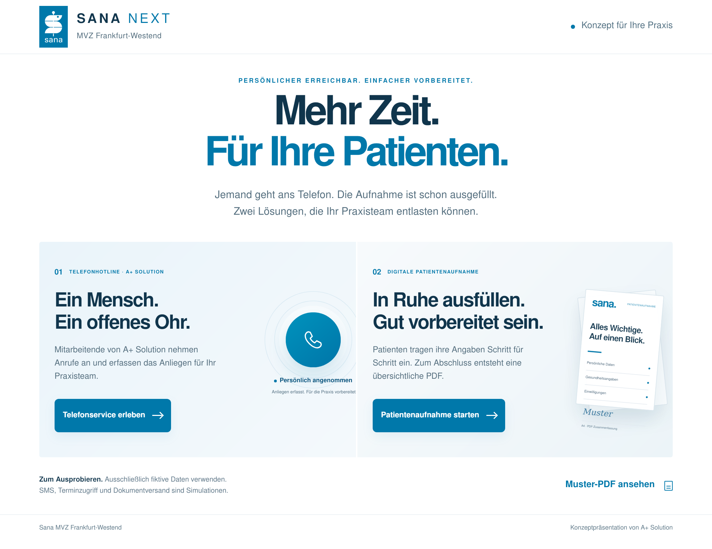

# SANA NEXT · Präsentationsfassung

Stand: 3. November 2026

Die Präsentation erklärt zwei Lösungen auf einen Blick: persönliche Telefonannahme durch Mitarbeitende von A+ Solution und eine digitale Patientenaufnahme in fünf Schritten. Beide Demos sind direkt erreichbar.

- **Gestaltung:** SANA Blau und Weiß, ruhige Typografie, reduzierte Texte, dezente Animationen und eine für iPad optimierte Übersicht. Die Hochformatansicht hat ausreichend breite Textspalten.
- **Telefonservice:** Sämtliche bisherigen Felder und bedingten Abläufe bleiben erhalten. Die Live-Übersicht zeigt auch Versandempfänger und Gesprächsnotizen. Der Test-PIN ist ausschließlich lokal und wird bei geänderten Patientendaten ungültig.
- **Patientenaufnahme:** Größere Schrift und Berührungsflächen, deutliche Vor- und Zurücknavigation, Fehlermeldungen am betroffenen Feld und eine vollständige Abschlussübersicht. Minderjährigenvertretung, Unterschrift und Pflichtbestätigung bleiben verbindlich. Freiwillige Einwilligungen bleiben frei wählbar.
- **PDF:** Durchsuchbarer Text mit eingebetteten Schriften, korrekte Umlaute, vollständige Antworten, automatische A4-Umbrüche, wiederholte Abschnittsüberschriften, Unterschrift beziehungsweise Sichtvermerk und „Seite X von Y“. Beide Muster bestehen aus zwei A4-Seiten. Lange Antworten werden auf weiteren Seiten fortgesetzt.
- **Sicherheit:** Der Präsentationslink zur Aufnahme erzwingt den lokalen Demo-Modus. Es wurden weder echte SMS noch Terminbuchungen oder Dokumentversand angeschlossen. Backend, D1-Verschlüsselung, Zugriffsschutz und Aktivierungssperren bleiben erhalten.

## Prüfung

20 automatisierte Prüfungen für Datenvalidierung, Einwilligungen, Verschlüsselung, Aktivierung und PDF-Vollständigkeit; zusätzlich 20 vollständige Browserprüfungen:

| Umgebung | Geprüfte Abläufe |
| --- | --- |
| Desktop / Chromium | Präsentation, Telefonservice, Patientenaufnahme, Minderjährigenvertretung |
| Android / Chromium | Dieselben vier Abläufe |
| iPad quer / WebKit | Dieselben vier Abläufe |
| iPad hoch / WebKit | Dieselben vier Abläufe |
| iPhone / WebKit | Dieselben vier Abläufe |

Enthalten sind Rückwege, Pflichtfelder, alle Anliegenarten und Versandwege, alle Terminoptionen, bedingte Gesundheitsfelder, falscher und richtiger Test-PIN, Zurücksetzen der Prüfung, freiwillige Einwilligungen, Informationsdialoge, Unterschrift sowie tatsächliche PDF-Downloads. Die Dateien werden anschließend auf A4-Abmessungen, Seitenzahlen und vollständige Textinhalte einschließlich langer Freitexte und Umlaute geprüft. PDF-Seiten wurden zusätzlich gerendert und visuell kontrolliert.

Die Safari-Prüfung erfolgt mit WebKit und emulierten Gerätegrößen. Ein physisches iPad, Apple Pencil, AirDrop und die native Dateien-App wurden hier nicht getestet.

## Für die Vorführung

1. `/vision/` öffnen und eine der beiden Lösungen antippen.
2. Im Telefonservice „Beispiel laden“, in der Aufnahme „Beispiel eintragen“ verwenden.
3. Die Muster-PDF direkt aus der Übersicht öffnen oder nach dem Ausfüllen eine eigene Demo-PDF erzeugen.

Ausschließlich fiktive Angaben verwenden. Die PDFs bestätigen keine Übermittlung an die Praxis.

